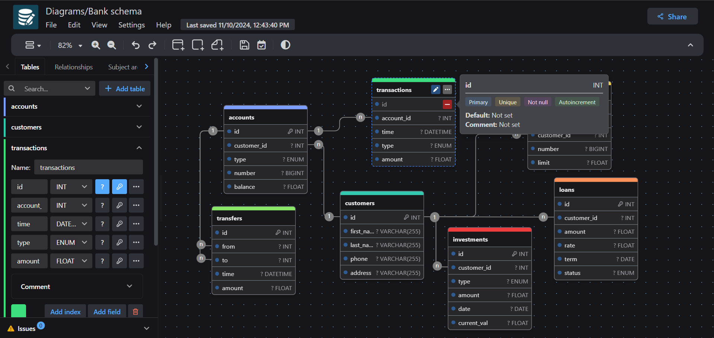

<div align="center">
    
    <h1>drawDB</h1>
</div>

<h3 align="center">免费、简洁、直观的数据库架构编辑器与 SQL 生成器</h3>

<div align="center" style="margin-bottom:12px;">
    <a href="https://drawdb.app/" style="display: flex; align-items: center;">
        
    </a>
    <a href="https://discord.gg/BrjZgNrmR6" style="display: flex; align-items: center;">
        
    </a>
    <a href="https://x.com/drawDB_" style="display: flex; align-items: center;">
        
    </a>
</div>

<h3 align="center"></h3>

DrawDB 是一款强大且易用的数据库实体关系图（ERD）编辑器，完全运行于你的浏览器之中。无需注册账号，只需几次点击即可构建图表、导入与导出 SQL 脚本、生成迁移脚本、自定义编辑器等。完整功能请查看[这里](https://drawdb.app/)。

## 快速上手

### 本地开发

```bash
git clone https://github.com/drawdb-io/drawdb
cd drawdb
npm install
npm run dev
```

### 构建

```bash
git clone https://github.com/drawdb-io/drawdb
cd drawdb
npm install
npm run build
```

### Docker 构建

```bash
docker build -t drawdb .
docker run -p 3000:80 drawdb
```

如需启用图表共享功能，请部署配套的[服务端仓库](https://github.com/drawdb-io/drawdb-server)，并参照 `.env.sample` 配置环境变量。**除非你需要分享文件，否则此步骤可选。**

使用 Docker 镜像时，只需在启动容器时传入服务端 URL 即可，**无需重新构建**：

```bash
docker run -p 3000:80 -e VITE_BACKEND_URL=https://your-drawdb-server.example.com ghcr.io/drawdb-io/drawdb:latest
```

## 贡献指南

有关本项目的贡献规范，请参阅 [CONTRIBUTING.md](CONTRIBUTING.md)。

## 支持
- 加入社区讨论：[Discord](https://discord.gg/BrjZgNrmR6)
